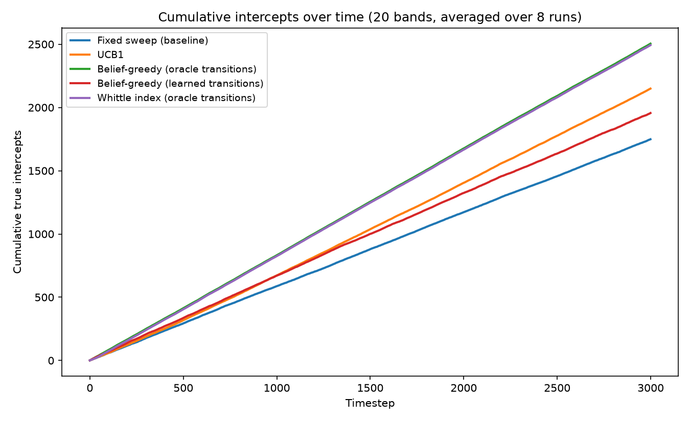
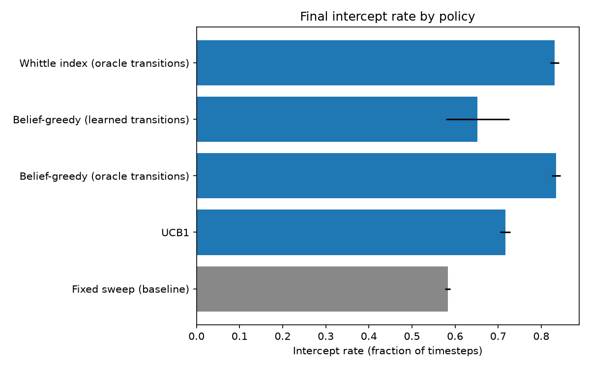

# ARGUS — Adaptive Restless-Bandit Guided Universal Scanner

**An adaptive, learning-based spectrum-scanning scheduler for Electronic Warfare Support Measures (ESM).**

[](https://www.python.org/)
[](https://github.com/cysterio/BanditOPS)

ARGUS is a software-based approach to adaptive spectrum scanning that replaces fixed, open-loop scanning with a closed-loop scheduling strategy. It estimates the changing activity of frequency bands, prioritizes promising bands, learns from new observations, and incorporates metadata-integrity checks.

Developed by **Team BanditOps** for Smart India Hackathon 2026.

## Problem Statement

- **Problem Statement ID:** 26055
- **Title:** Smart Scan Strategy for Electronic Warfare
- **Theme:** Robotics and Drones
- **Category:** Software
- **Team ID:** T005

### The Problem

Conventional fixed-sweep scanning follows a predetermined sequence of frequency bands, regardless of what has already been observed.

This can lead to:
- Missed interception opportunities when emitters are active between scans.
- Unnecessary scanning of less informative frequency bands.
- Delayed detection of changing or intermittent emitters.
- Reduced efficiency when monitoring resources are limited.
- Incorrect pulse descriptor word (PDW) metadata affecting downstream analysis and model training.

## Our Solution: ARGUS

ARGUS uses a restless multi-armed bandit framework to determine which frequency band should be scanned next.

Each frequency band is treated as a dynamic process whose activity can change over time, even when it is not being observed. Rather than relying entirely on a fixed scan sequence or prior intelligence, ARGUS maintains beliefs about band activity and updates its priorities as new measurements arrive.

### Core Principles

- **Data Cleaner:** Evaluates detection confidence and checks measurement and metadata integrity.
- **Chasing the Threat:** Prioritizes frequency bands based on estimated activity and recent observations.
- **Checking Blind Spots:** Accounts for neglected bands so potentially important signals are not ignored indefinitely.

### System Workflow

```text
Raw TSRD Dataset
       |
       v
TSRD Data Adapter
       |
       v
Aggregate Transitions
       |
       v
Sanitize Transitions
       |
       v
Restless-Bandit Scheduler
       |
       v
Policy-Based Band Selection
       |
       v
Detection & Metrics Evaluation
       |
       v
Update Beliefs and Learn
       |
       +------> Repeat
```

The scheduling loop follows:

**Sense → Filter → Score → Prioritize → Hop → Learn → Repeat**

## Key Features

- **Adaptive scan scheduling:** Selects the next band using current estimates instead of following only a predetermined sequence.
- **Restless-bandit optimization:** Uses Whittle Index scheduling to prioritize frequency bands with changing activity.
- **Bayesian belief tracking:** Maintains estimates of band activity using a two-state Markov model.
- **Online learning:** Supports learning transition probabilities from observations.
- **Baseline comparisons:** Evaluates adaptive strategies against fixed sweep and UCB1 policies.
- **Metadata integrity:** Includes transition sanitization to address potentially inconsistent PDW metadata.
- **Performance evaluation:** Measures interception rate, coverage, interception latency, empirical detection probability, and false-alarm probability.
- **Reproducible experiments:** Uses controlled random seeds and repeated simulation runs for policy comparisons.

## Technology Stack

| Component | Technologies |
|---|---|
| Programming language | Python 3.10+ |
| Numerical computing | NumPy, SciPy |
| Data handling | h5py, JSON, NPZ |
| Scheduling algorithms | Whittle Index, UCB1, belief-greedy |
| Probabilistic modeling | Two-state Markov chains, Bayesian belief tracking |
| Dataset | Turing Synthetic Radar Dataset (TSRD) |
| Visualization | Matplotlib |
| Development tools | VS Code, Git, GitHub |

## Scheduling Policies

ARGUS evaluates multiple scheduling approaches using a shared policy interface.

| Policy | Description |
|---|---|
| Fixed Sweep | Scans bands in a predetermined order; baseline |
| UCB1 | Balances exploration and exploitation using upper confidence bounds |
| Belief-Greedy | Selects the band with the highest current activity belief |
| Whittle Index | Prioritizes bands using their calculated Whittle indices |

The Whittle policy uses a UCB-based warm-up period before relying on index-based scheduling. The experiments also compare policies using known transition probabilities against variants that learn transitions online.

## Results and Evaluation

The SIH 2026 proposal reports the following results:

| Metric | Reported result |
|---|---|
| Interception rate — Whittle policy | Approximately 72% |
| Interception rate — fixed-sweep baseline | Approximately 29% |
| Relative interception-rate improvement | Approximately 2.5× |
| Average interception latency | Approximately 60% lower |
| Synthetic evaluation | 20 frequency bands |
| Repeated experiments | 8 independent runs |
| Timesteps per run | 3,000 |

The repository also includes real-data experiment scripts and evaluation plots based on TSRD-related data.

### Evaluation Visualizations

**Cumulative Interceptions**



Compares cumulative interception performance across scheduling policies.

**Interception Rate Comparison**



Compares the final interception rate of the evaluated policies.

Additional plots from the repository include `real_data_cumulative_intercepts.png` and `real_data_intercept_rate_bar.png`.

> **Important:** The figures above are reported results from the project presentation, not a guarantee of real-world receiver performance. Results depend on the dataset, simulation assumptions, transition model, and evaluation configuration. Real-hardware validation remains necessary.

## Repository Structure

```text
BanditOPS/
├── belief.py                       # Belief-state tracking
├── env.py                          # Spectrum simulation environment
├── policies.py                     # Scheduling policies
├── whittle.py                      # Whittle Index computation
├── metrics.py                      # Performance metrics
├── tsrd_adapter.py                 # TSRD data adapter
├── aggregate_transitions.py        # Transition aggregation
├── sanitize_transitions.py         # Transition sanitization
├── download_data.py                # Dataset download utilities
├── inspect_data.py                 # Dataset inspection
├── inspect_metadata.py             # Metadata inspection
├── run_experiment.py               # Synthetic policy comparison
├── real_data_experiment.py         # Real-data experiments
├── presentation_demo.py             # Demonstration script
├── aggregated_transitions.json     # Aggregated transition data
├── aggregated_transitions.npz      # NumPy transition archive
├── env_ready_transitions.json      # Sanitized transition data
├── env_ready_transitions.npz       # Environment-ready archive
├── cumulative_intercepts.png       # Synthetic results plot
├── intercept_rate_bar.png          # Synthetic comparison plot
├── real_data_cumulative_intercepts.png
├── real_data_intercept_rate_bar.png
└── metadata_output.txt
```

## Getting Started

### Prerequisites

- Python 3.10 or later
- Git
- pip

### 1. Clone the Repository

```bash
git clone https://github.com/cysterio/BanditOPS.git
cd BanditOPS
```

### 2. Create a Virtual Environment

```bash
python -m venv .venv
```

Activate it:

**Windows**
```bash
.venv\Scripts\activate
```

**macOS / Linux**
```bash
source .venv/bin/activate
```

### 3. Install Dependencies

```bash
python -m pip install numpy scipy matplotlib h5py
```

These are the documented technology-stack dependencies; additional packages may be needed by individual dataset or experiment scripts.

### 4. Run the Synthetic Experiment

```bash
python run_experiment.py
```

This script evaluates the configured scheduling policies over repeated simulation runs, prints a comparison of performance metrics, and generates cumulative-interception and interception-rate plots.

### 5. Explore the Other Scripts

```bash
python presentation_demo.py
python real_data_experiment.py
```

The demonstration and real-data experiment may require additional setup or dataset files. Consult the relevant script before running them.

**Note:** The commands above describe the available entry points. A clean installation and end-to-end execution of every script should be verified before treating them as fully tested setup instructions.

## Data and Storage

ARGUS uses JSON and NumPy NPZ files for transition data, intermediate processing, and caching.

The project workflow includes:
1. Loading and inspecting TSRD data.
2. Mapping and aggregating transitions.
3. Sanitizing transition data.
4. Preparing environment-ready inputs.
5. Running experiments and storing evaluation outputs.

Dataset access, file paths, and any required downloads should be configured according to `download_data.py` and `tsrd_adapter.py`.

## Limitations and Future Work

The current approach has several limitations identified in the project proposal:

- **Sparse or noisy observations:** Belief estimates may converge slowly when detections are infrequent or false alarms are high.
- **Hardware switching constraints:** Actual scan speed is limited by receiver switching time, not just algorithmic computation.
- **Synthetic-to-real gap:** A synthetic dataset cannot capture every real-world interference pattern or environmental effect.
- **Adaptive emitters:** Frequency-agile emitters may change behavior faster than the scheduler can learn.
- **Validation requirements:** Performance must be evaluated on representative datasets and, ultimately, real receiver hardware.

Potential next steps include broader real-data evaluation, improved transition estimation, hardware-in-the-loop testing, and further optimization of scheduling latency.

## Applications

The underlying adaptive scheduling approach may also be relevant to:

- Electronic Support Measures (ESM) and spectrum surveillance.
- Cognitive radio and dynamic spectrum sharing.
- RF sensing and interference monitoring.
- Resource allocation in systems with limited sensing capacity.
- Other sequential decision-making problems involving changing environments.

## References

1. Gunn et al., *The Turing Synthetic Radar Dataset: A Dataset for Pulse Deinterleaving*, arXiv:2602.03856, 2026.
2. Alan Turing Institute, *Turing Deinterleaving Challenge*, 2026.
3. C. Adams, *Cognitive Electronic Warfare: Radio Frequency Spectrum Meets Machine Learning*, Avionics Magazine, 2018.
4. D. B. Harrison, S. M. Lopata, and C. R. Skarda, *Cognitive Electronic Warfare Scheduler*, US Patent 11,747,438, 2023.
5. P. Whittle, *Restless Bandits: Activity Allocation in a Changing World*, Journal of Applied Probability, 1988.
6. P. Auer, N. Cesa-Bianchi, and P. Fischer, *Finite-Time Analysis of the Multiarmed Bandit Problem*, Machine Learning, 2002.
7. K. Wang et al., *Optimistic Whittle Index Policy: Online Learning for Restless Bandits*, AAAI, 2023.
8. L. P. Kaelbling, M. L. Littman, and A. R. Cassandra, *Planning and Acting in the Presence of Uncertainty: POMDPs*, Artificial Intelligence, 1998.

---

**ARGUS — Sense smarter. Prioritize dynamically. Learn continuously.**
